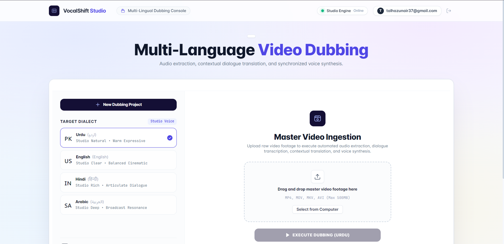

# 🎬 VocalShift Studio

<p align="center">
  <strong>An automated, end-to-end multi-lingual video dubbing and translation studio powered by FastAPI, Celery, Whisper, Gemini, Edge-TTS, and a Next.js 15 App Router frontend.</strong>
</p>

<p align="center">
  
  
  
  
  
  
  
  
</p>

<p align="center">
  
</p>

---

## 🌟 Overview

**VocalShift Studio** is a production-ready, full-stack automated video dubbing application. It takes raw video footage in any source language and automatically separates dialogue, transcribes speech, generates culturally nuanced translations, synthesizes synchronized neural voices, and packages the result into a clean, ready-to-stream MP4 video.

The application couples an asynchronous background task queue architecture with a bespoke, human-crafted Next.js 15 studio interface featuring dual-track synchronized playback, live pipeline telemetry, and multi-dialect translation.

---

## ⚡ The Studio Pipeline

```
[ Master Video Ingestion ]
            │
            ▼
[ 1. Audio Separation ]     ───► MoviePy & FFmpeg isolate clean 48kHz acoustic dialogue
            │
            ▼
[ 2. Speech Recognition ]   ───► OpenAI Whisper generates time-coded verbatim transcript
            │
            ▼
[ 3. Dialogue Translation ] ───► Google Gemini (gemini-2.5-flash) translates matching dialect cadence
            │
            ▼
[ 4. Voice Synthesis ]      ───► Edge-TTS synthesizes high-fidelity neural speech
            │
            ▼
[ 5. Video Multiplexing ]   ───► Lossless remuxing harmonizes dubbed audio into master video
            │
            ▼
[ Dual-Track Player & Export ]
```

---

## ✨ Features

### 🖥️ Next.js 15 Studio Frontend
- **🎨 Bespoke Studio Design System:** High-contrast midnight indigo accents (`#140F35`), luminous pearl ambient canvas (`#F6F8FD`), crisp typography, and standard hairline icon strokes (`strokeWidth={1.5}`) with zero generic AI tropes.
- **🎥 Synchronized Dual-Track Comparison Player:** Side-by-side or A/B toggle playback with locked scrubbers, master vs. dubbed audio track isolation, fullscreen mode, and direct MP4 export.
- **📊 Real-Time Pipeline Telemetry:** 5-stage progress monitor tracking real-time status (`1/5` to `5/5`), elapsed runtime, job UUID, and automated diagnostic report drawer.
- **🌐 Dialect Selector:** Support for Urdu (`[UR]`), English (`[EN]`), Hindi (`[HI]`), and Arabic (`[AR]`) with ISO region chips, native typography, and acoustic voice profile descriptions.
- **📁 Studio Asset Storage Deck:** Local session history displaying ingested master footage and status.
- **🔐 Client Session Management:** Persistent JWT Bearer token authentication with automated session refresh and guest mode support.

### ⚙️ Asynchronous Backend Engine
- **🚀 1-Click Asynchronous Pipeline:** Non-blocking task dispatch returning an immediate Celery `task_id` with continuous polling status endpoints.
- **🎙️ Neural Speech Recognition (ASR):** Whisper model integration for robust timestamped dialogue extraction.
- **🌍 Contextual Semantic Translation:** Google Gemini API integration for tone-aware, culturally accurate translation.
- **🗣️ Expressive Neural Voice Synthesis:** Microsoft Edge-TTS neural speech engine with multi-speaker mappings.
- **🗄️ PostgreSQL Database (SQLAlchemy 2.0):** Type-safe `Mapped` models for persistent user accounts.
- **⚡ Celery & Redis Task Queue:** Multi-container task queue for CPU-intensive video rendering and demuxing.

---

## 📁 Repository Structure

```
AudioTrackChanger/
├── docker-compose.yml          # Root multi-container orchestration (All 5 services)
├── README.md                   # Project documentation
│
├── Frontend/                   # Next.js 15 App Router Web Client
│   ├── app/                    # Pages & routing (/, /login, /register, /studio)
│   ├── components/             # UI components (Navbar, VideoPlayer, PipelineTracker, Toast)
│   ├── context/                # AuthContext (JWT session management)
│   ├── lib/                    # API client (Fetch wrappers, media streaming helpers)
│   ├── types/                  # TypeScript interface contracts
│   ├── Dockerfile              # Next.js production container specification
│   ├── package.json
│   └── tailwind.config.ts      # Custom studio theme tokens
│
└── Backend/                    # FastAPI & Celery Engine
    ├── app.py                  # FastAPI application entrypoint & static media mounts
    ├── config.py               # Application settings & environment variables
    ├── database.py             # SQLAlchemy 2.0 database engine
    ├── models.py               # User and task database models
    ├── routers/                # API router modules (auth, pipeline, video, audio, etc.)
    ├── src/                    # Pipeline core logic & Celery task definitions
    ├── Dockerfile              # Backend Python container specification
    ├── docker-compose.yml      # Standalone backend service compose
    └── pyproject.toml
```

---

## 🛠️ Tech Stack

| Domain | Technology | Purpose |
| :--- | :--- | :--- |
| **Frontend Framework** | [Next.js 15](https://nextjs.org/) (App Router) | Client application & SSR pages |
| **Frontend Styling** | [Tailwind CSS 3.4](https://tailwindcss.com/) | Bespoke studio design system |
| **Iconography** | [Lucide React](https://lucide.dev/) (1.5px stroke) | Precision studio iconography |
| **Backend Framework** | [FastAPI](https://fastapi.tiangolo.com/) | High-performance asynchronous REST API |
| **Task Queue & Broker** | [Celery](https://docs.celeryq.dev/) + [Redis](https://redis.io/) | Distributed background video processing |
| **Speech-to-Text** | [OpenAI Whisper](https://github.com/openai/whisper) | Accurate speech transcription |
| **Translation Engine** | [Google Gemini API](https://ai.google.dev/) | Contextual multi-language translation |
| **Voice Synthesis** | [Edge-TTS](https://github.com/rany2/edge-tts) | Neural voice generation |
| **Video Processing** | [MoviePy](https://zulko.github.io/moviepy/) + [FFmpeg](https://ffmpeg.org/) | Audio extraction and video remuxing |
| **Database & ORM** | [PostgreSQL 16](https://www.postgresql.org/) + [SQLAlchemy 2.0](https://www.sqlalchemy.org/) | User management & data persistence |
| **Containerization** | [Docker](https://www.docker.com/) & Docker Compose | 5-container full-stack orchestration |

---

## 🚀 Quick Start with Docker (Recommended)

Run the entire full-stack application (Database, Redis, FastAPI Backend, Celery Worker, and Next.js Frontend) with a single command from the project root.

### Prerequisites
- [Docker Desktop](https://www.docker.com/products/docker-desktop/) installed and running.
- A [Google Gemini API Key](https://aistudio.google.com/).

### 1. Configure Environment Variables
Create a `.env` file in the `Backend/` directory:
```bash
cp Backend/.env.example Backend/.env
```
Ensure your `Backend/.env` contains your Gemini API key:
```env
GEMINI_API_KEY=your_actual_gemini_api_key_here
SECRET_KEY=your_secure_jwt_secret_key
ALGORITHM=HS256
ACCESS_TOKEN_EXPIRE_MINUTES=60
```

### 2. Launch Full-Stack Application
From the root repository folder (`AudioTrackChanger`), execute:
```bash
docker compose up --build -d
```

### 3. Access Services
- 🎬 **Studio Frontend:** [http://localhost:3000](http://localhost:3000)
- 🌐 **FastAPI Swagger API Docs:** [http://localhost:3003/docs](http://localhost:3003/docs)
- 🐘 **PostgreSQL:** `localhost:5432`
- 🔴 **Redis:** `localhost:6379`

To stop all services:
```bash
docker compose down
```

---

## 💻 Manual Local Development Setup

If you prefer to run services natively on your host machine without Docker:

### 1. Start Database & Redis
Ensure PostgreSQL (port 5432) and Redis (port 6379) are running locally.

### 2. Backend Setup
```bash
cd Backend

# Create and activate Python virtual environment
python -m venv .venv
.venv\Scripts\activate       # Windows PowerShell
# source .venv/bin/activate  # macOS / Linux

# Install dependencies
pip install -r pyproject.toml

# Start Celery Worker (Terminal 1)
python -m celery -A src.celery_app.celery_app worker --loglevel=info --pool=solo

# Start FastAPI Server (Terminal 2)
python app.py
```
*Backend runs on `http://localhost:3003`.*

### 3. Frontend Setup
```bash
cd Frontend

# Install dependencies
npm install

# Start development server
npm run dev
```
*Frontend runs on `http://localhost:3000`.*

---

## 📖 API Documentation

Access interactive Swagger documentation at `http://localhost:3003/docs`.

### Key Endpoints:

#### 🔐 Authentication (`/api/auth`)
- `POST /api/auth/register` - Register a new studio user account
- `POST /api/auth/login` - Authenticate and obtain JWT Bearer access token
- `GET /api/auth/profile` - Verify token and retrieve user profile

#### 🚀 1-Click Dubbing Pipeline (`/api/pipeline`)
- `POST /api/pipeline/start` - Upload master video footage & dispatch background dubbing worker
- `GET /api/pipeline/task_status/{task_id}` - Poll progress stage (`1/5` to `5/5`) and error state
- `GET /api/pipeline/download_video/{filename}` - Download rendered dubbed MP4 file

#### 📁 Storage & Asset Streams
- `GET /uploads/{filename}` - Stream master video footage
- `GET /temp/{filename}` - Stream intermediate audio tracks
- `GET /output/{filename}` - Stream rendered dubbed videos
- `GET /api/video/list_upload_files` - List ingested studio assets

---

## 🗺️ Roadmap

- [ ] Dynamic voice selection per target language in Swagger UI.
- [ ] SRT subtitle generation and burning option.
- [ ] Speaker diarization (multi-speaker detection).
- [ ] Voice cloning integration for actor voice preservation.

---

## 👤 Author

Developed by **[Talha Zunair](https://github.com/TalhaHEX)**  
Contact: [talhazunair37@gmail.com](mailto:talhazunair37@gmail.com)

---

## 📄 License

This project is licensed under the [MIT License](LICENSE).
